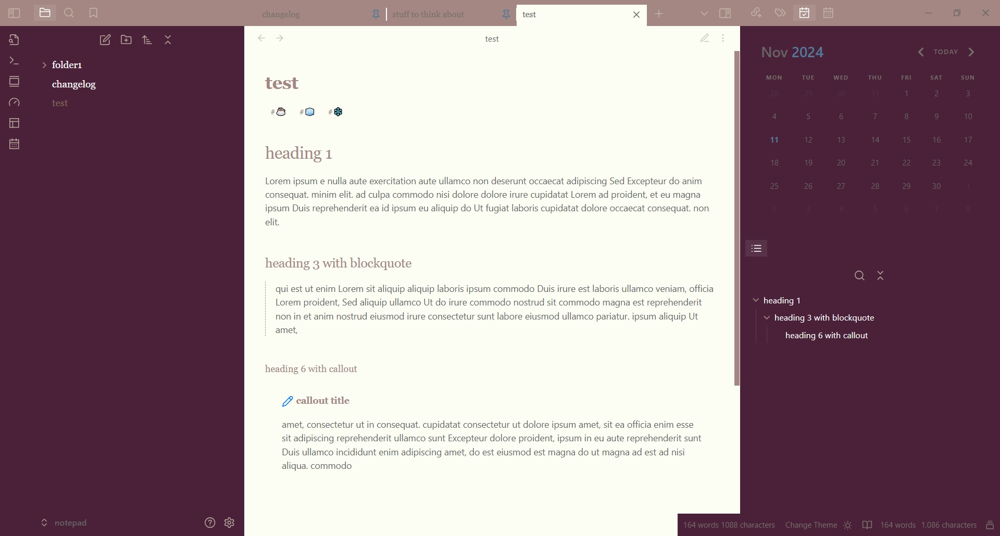

# Winter Spices

A simple, minimalist, cozy theme.

Good for writing long text and journalling.

Used fonts: Georgia, YU Gothic

It will look the same in light and dark mode, but works best in light mode.

Update: This theme is getting an update to make code more readable.

## Installation

1. Open Obsidian and go to **Settings > Appearance**.
2. Next to **Themes**, select **Manage**.
3. Search for "Winter Spices", then select **Install and use**.

To install by hand, download `manifest.json` and `theme.css` from the [latest release](https://github.com/incantatem2/Obsidian-winter-spices/releases/latest). Put both files in a folder named `Winter Spices` inside `.obsidian/themes/` in your vault. Then choose the theme under **Settings > Appearance > Themes**.
